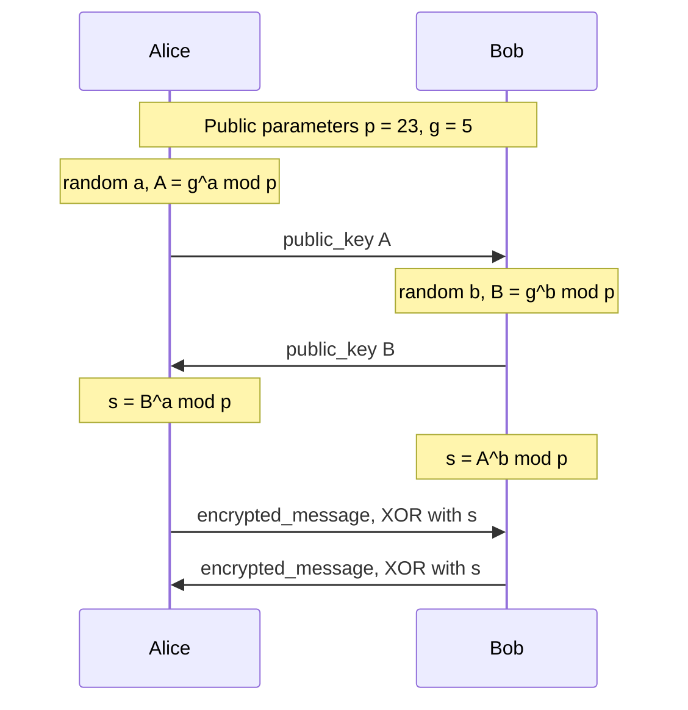
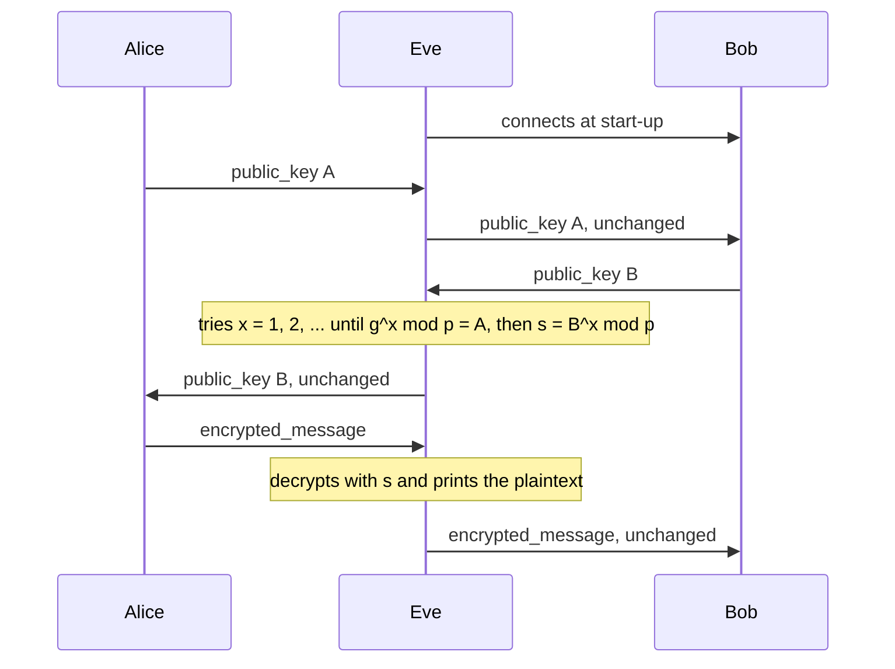

# diffie-hellman-demo

A teaching demo of the Diffie-Hellman key exchange: Alice and Bob agree on a shared secret over WebSockets, and Eve, relaying their traffic, recovers it by brute force because the parameters are deliberately tiny.

## Quick start

Requires [Bun](https://bun.sh) (tested with 1.4.4). The scripts in `package.json` call `node`: Bun runs them with Node.js when it is on your `PATH` (tested with Node 26) and with its own runtime otherwise.

```sh
git clone https://github.com/Fede-Berga/diffie-hellman-demo.git
cd diffie-hellman-demo
bun install
```

Each party is an interactive process. Open one terminal per party and start them in this order:

```sh
# Honest exchange
bun run bob     # terminal 1: server on port 8080
bun run alice   # terminal 2

# Eve in the middle
bun run bob     # terminal 1
bun run eve     # terminal 2: connects to Bob, listens on port 8081
bun run alice   # terminal 3
```

Alice tries Eve's port first and falls back to Bob's, so the same command serves both scenarios. Once the keys are exchanged, type a line at the `Alice>` or `Bob>` prompt to send it. Each process handles a single conversation: stop all of them with Ctrl+C before the next run.

## How it works

`shared/crypto.js` holds the public parameters (p = 23, g = 5), square-and-multiply modular exponentiation, private-key generation and a toy XOR cipher. The parties exchange JSON messages: `public_key` carries A or B, `encrypted_message` carries base64 ciphertext.



Both sides obtain the same s because (g^b)^a = (g^a)^b mod p, and neither a nor b leaves its process.

With Eve running, Alice's connection lands on Eve, who relays every message unchanged. Bob cannot tell the difference: he prints `Alice connected!` when Eve connects to him.



## What each party prints

- **Bob**: when Alice's public key arrives, the parameters, his private key b, B = g^b mod p and s = A^b mod p with the numbers filled in; then a `Bob>` prompt and every incoming message, decrypted.
- **Alice**: the same for her side (a, A = g^a mod p, s = B^a mod p), then an `Alice>` prompt.
- **Eve**: every relayed message with its direction and type, the brute-force search, the recovered secret and the plaintext of each chat message. From one run:

```text
Trying to find Alice's private key (a):
✓ Found Alice's private key: a = 19 (after 19 attempts in 0ms)

🎯 EVE CRACKED THE SHARED SECRET: 2
   Calculated as: B^a mod p = 13^19 mod 23 = 2
...
📨 INTERCEPTED from Alice → Bob:
   Type: encrypted_message
   🔒 Encrypted data: eldeXl0ScF1Q...
   🔓 EVE SUCCESSFULLY DECRYPTED: "Hello Bob"
```

## Limitations

This is teaching material, not cryptography to reuse.

- Toy parameters: p = 23, and private keys come from `Math.random()` in the range 2 to 20, so there are 19 possible keys. The arithmetic uses JavaScript numbers and does not scale to real key sizes.
- The cipher XORs the text with the decimal digits of s. It stands in for real encryption and protects nothing.
- Eve only listens. She shows why the discrete logarithm has to be infeasible to compute, not the active attack in which a man in the middle substitutes her own public keys. Nothing here authenticates the public keys, so that attack would succeed too; real protocols prevent it with signatures or certificates.
- Ports 8080 and 8081 are hard-coded, and there are no automated tests.

## License

[MIT](LICENSE)
